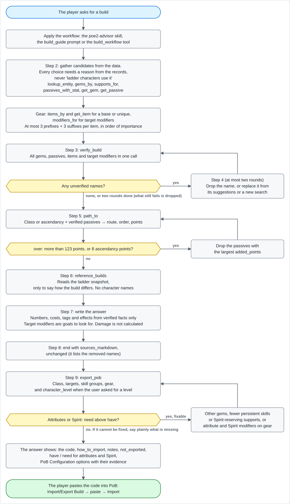
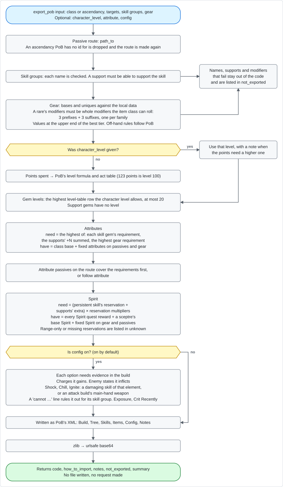
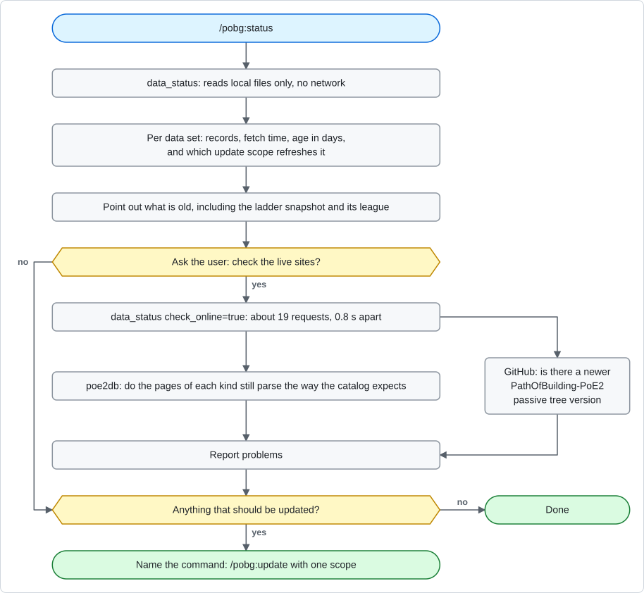
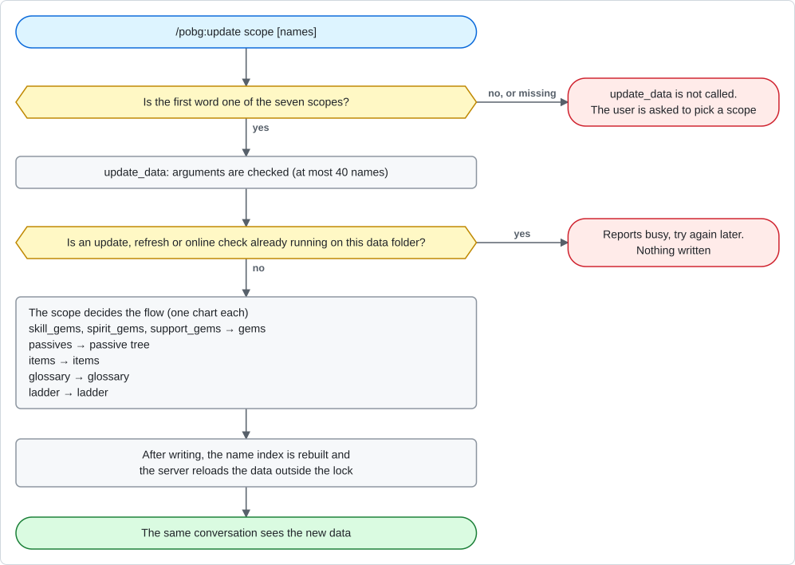
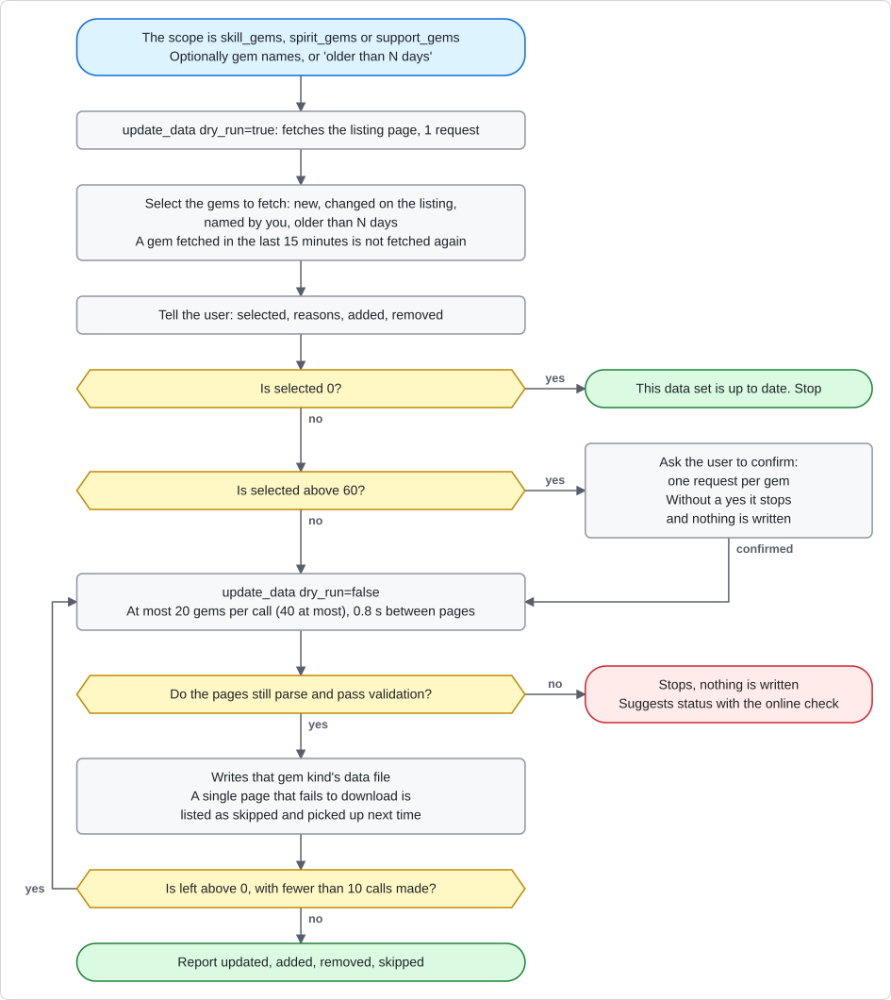
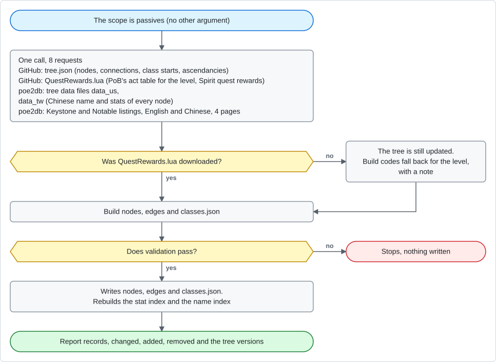
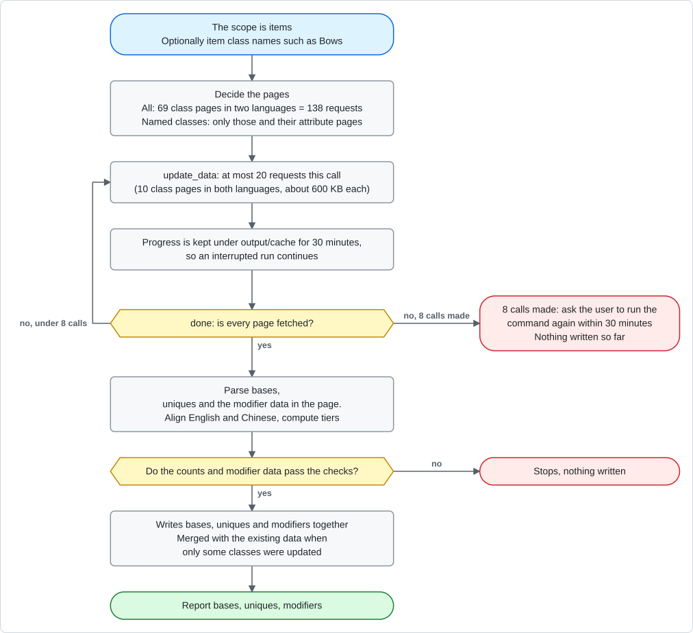
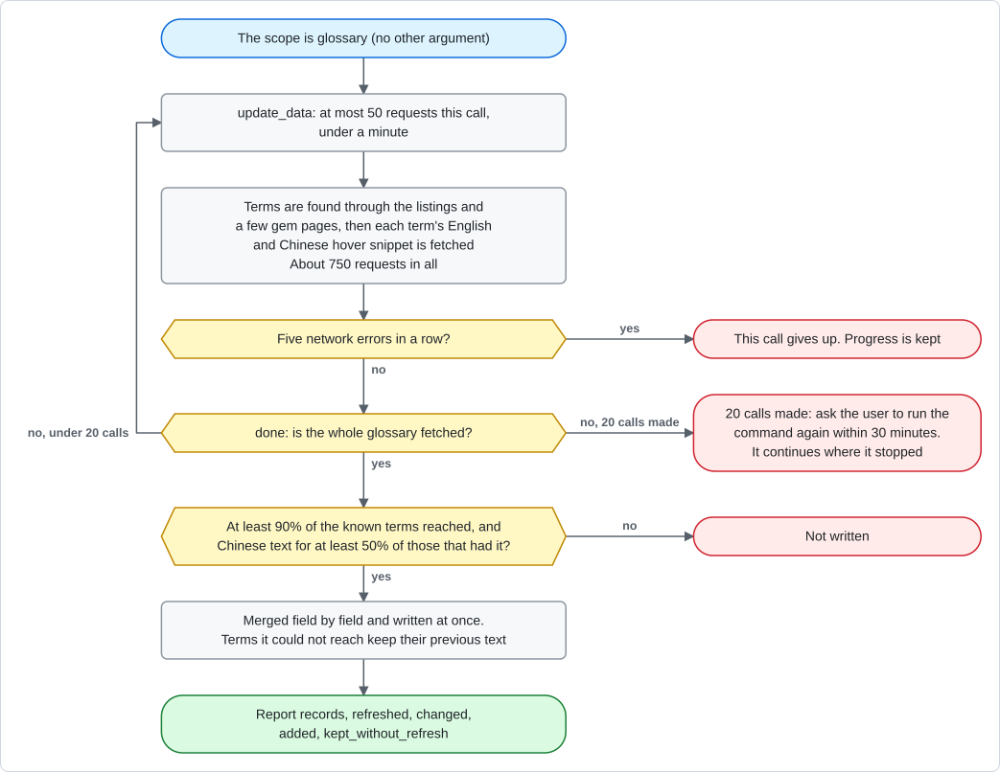
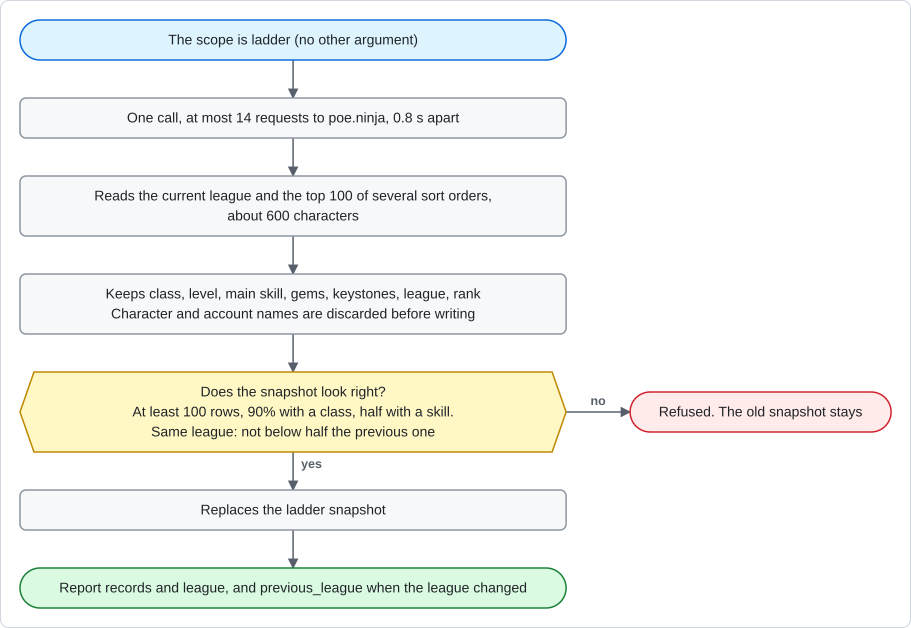
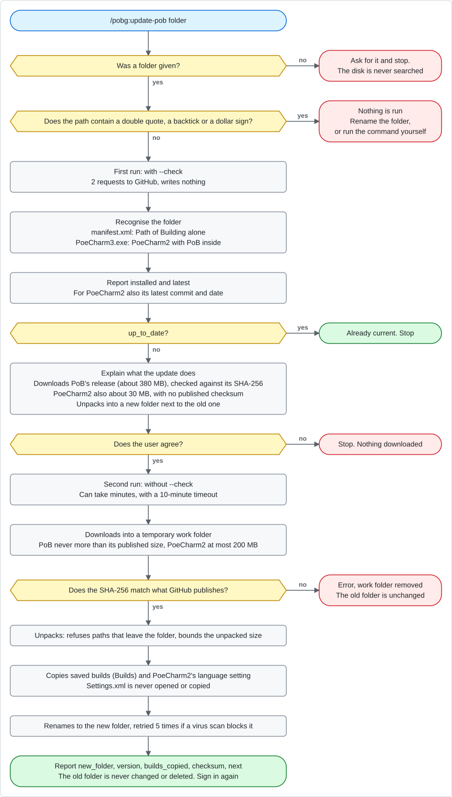

# Command flows

**English** | [繁體中文](commands.zh-TW.md)

POBG has four commands in Claude Code. This document draws the whole route of each one, from
what you type to where it ends: which tools are called, where a decision is made, what makes it
stop, and when data is written.

| Command | Purpose | Uses the network | Writes anything |
|---|---|---|---|
| [`/pobg:poe2-advisor`](#pobgpoe2-advisor-a-cited-build-answer) | Answers PoE2 questions, writes cited builds and PoB codes | No | No |
| [`/pobg:status`](#pobgstatus-how-old-is-the-data) | Record counts and age of each data set | Only when you agree to check the live sites (about 19 requests) | No |
| [`/pobg:update <scope>`](#pobgupdate-scope-update-one-data-set) | Re-fetches one data set | Yes | Yes, to `data/` after validation |
| [`/pobg:update-pob <folder>`](#pobgupdate-pob-folder-update-your-path-of-building) | Updates the Path of Building on your computer | Yes (GitHub) | Only a new folder next to the old one |

In other AI apps `status` and `update` are prompts of the `pobg` server and the build workflow
is the `build_guide` prompt or the `build_workflow` tool, with the same steps; `update-pob` is
the same program run from a terminal.

Legend: a blue rounded box is the start, a grey box an action, a yellow hexagon a decision, a green rounded box
a normal end, and a red rounded box a stop (nothing written).

The charts are drawn from [`commands_charts.json`](commands_charts.json) by [`render_charts.py`](render_charts.py)
(`python docs/flow/render_charts.py`, standard library only). To change a flow, edit the JSON and redraw; do not
edit the image files.

## `/pobg:poe2-advisor`: a cited build answer

You do not run it yourself: it is applied automatically when you ask Claude Code a PoE2 question
or ask for a build. The steps come from
[`src/tools/build_workflow.py`](../../src/tools/build_workflow.py). The whole route reads local
data only: no network, no file written.

### What `export_pob` works out

Character level, gem levels, attributes, Spirit and Configuration come from the data; the model
does not work them out.

## `/pobg:status`: how old is the data

From [`skills/status/SKILL.md`](../../skills/status/SKILL.md) and `status` / `online_check` in
`src/tools/maintenance.py`. This command never calls `update_data`.

A newer passive tree **version** is reported by status but not adopted by `update`; that needs a
new release of POBG.

## `/pobg:update <scope>`: update one data set

From [`skills/update/SKILL.md`](../../skills/update/SKILL.md) and `update` in
`src/tools/maintenance.py`. One scope per command; there is no "update everything". Every
request identifies itself (`POBG/0.10`) and waits 0.8 s before each page or file (0.3 s before a
hover snippet).

### Overview: the scope first

When any call returns an error, the error is shown and the command stops; it never tries another
scope. The update changes the copy of `data/` the server runs from.

### `skill_gems`, `spirit_gems`, `support_gems`

- A balance patch that only changes numbers does not change the listing page, so a plain update
  gets `selected` = 0. Name the gems from the patch notes, or ask for gems older than N days.
- poe2db lists every spirit gem among the skill gems too; such a gem is stored once and updated
  by `spirit_gems`.

### `passives`

### `items`

### `glossary`

### `ladder`

## `/pobg:update-pob <folder>`: update your Path of Building

From [`skills/update-pob/SKILL.md`](../../skills/update-pob/SKILL.md) and
`src/tools/pob_update.py`. Only the user can start this command; the model cannot run it on its
own. It is not an MCP tool: it runs `python -m src.tools.pob_update` from the plugin's folder.

- If the command is stopped part-way, a `.pobg-update-…` work folder may be left next to the old
  one; the next run removes it after an hour, or you can delete it.
- Once the new folder works, deleting the old one is up to you.
- The command for other AI apps or by hand: [docs/data.md](../data.md#updating-path-of-building).
