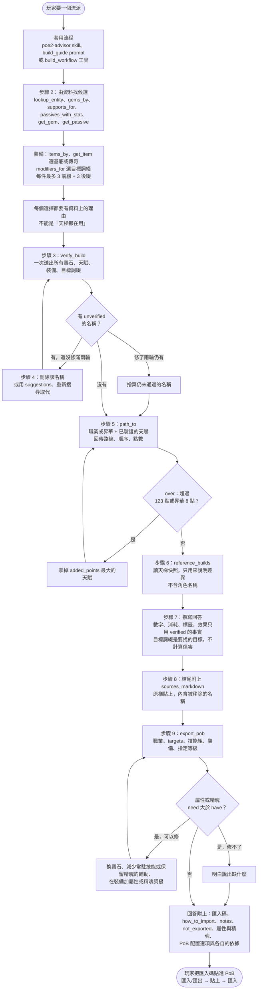
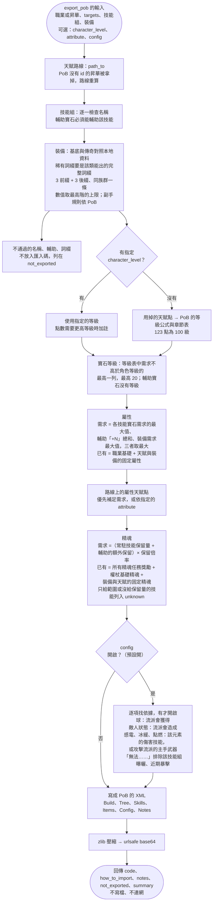
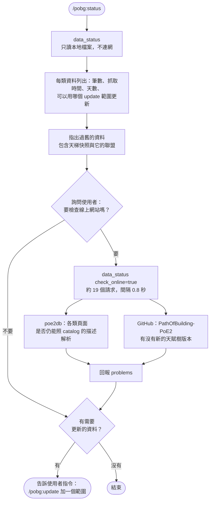
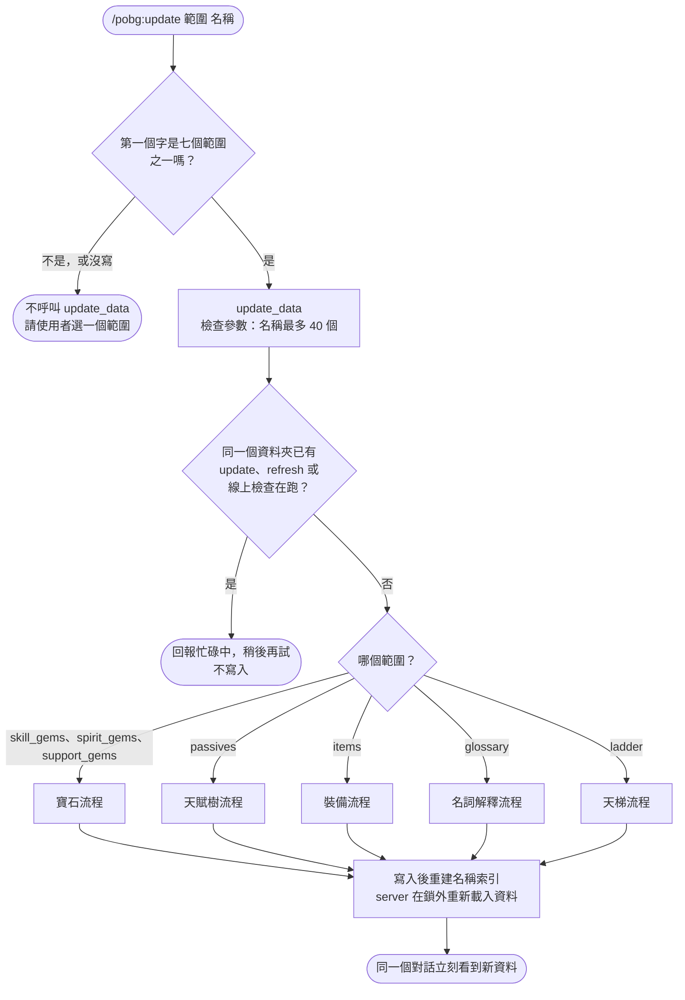
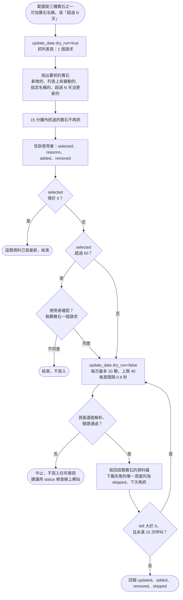
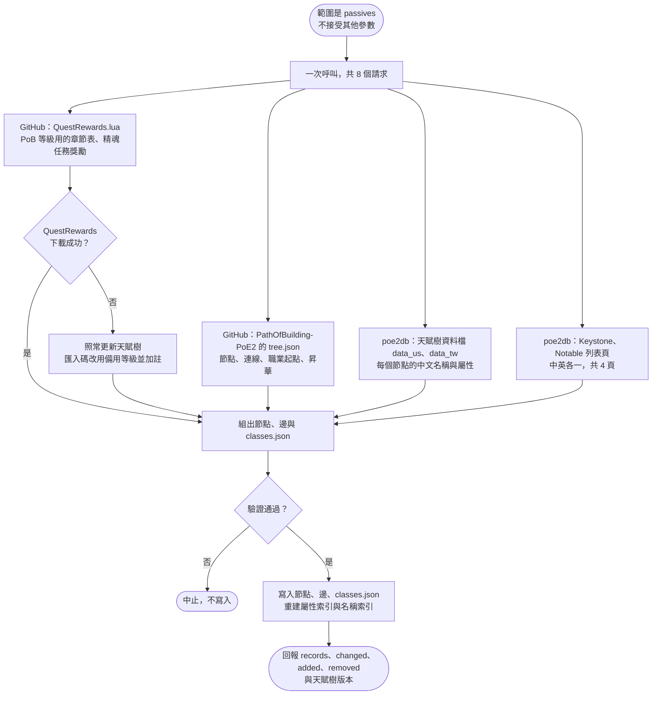
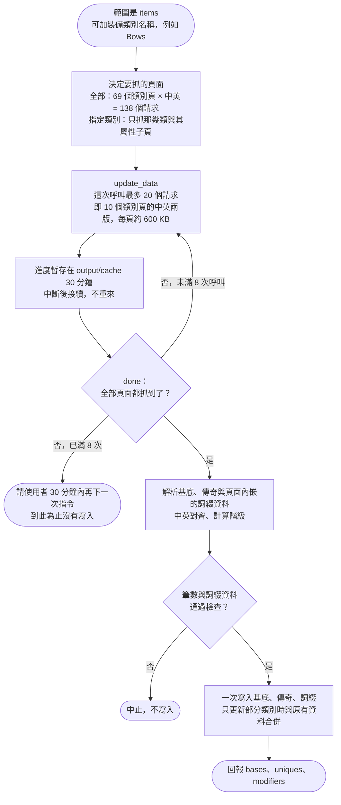
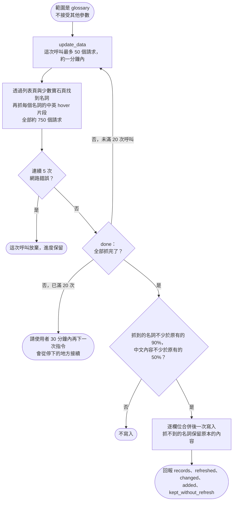
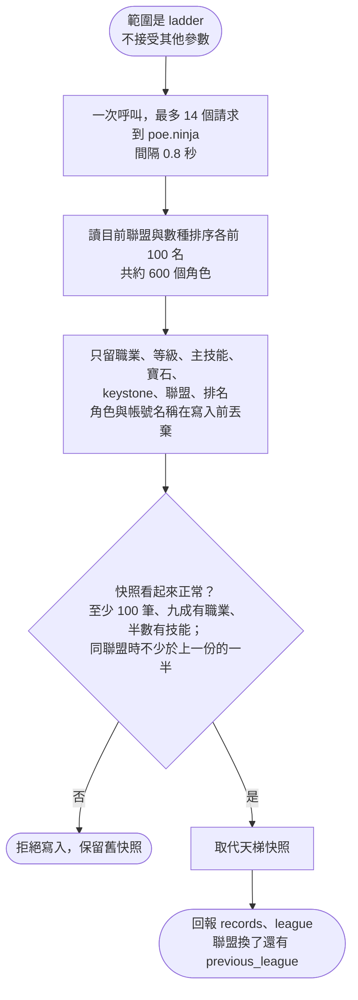
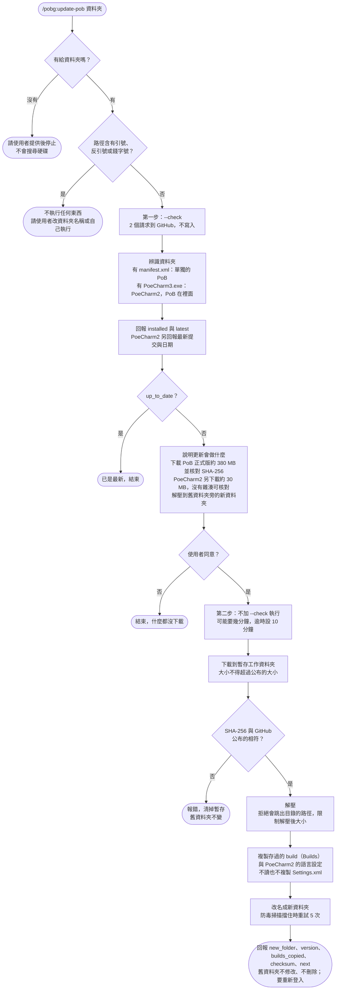

# 指令流程

[English](commands.md) | **繁體中文**

POBG 在 Claude Code 中有四個指令。這份文件畫出每個指令從輸入到結束的完整路線：會呼叫哪些工具、在哪裡做判斷、
什麼情況會停下來、什麼時候才寫入資料。

| 指令 | 用途 | 會連網嗎 | 會寫入嗎 |
|---|---|---|---|
| [`/pobg:poe2-advisor`](#pobgpoe2-advisor有出處的流派回答) | 回答 PoE2 問題、撰寫有出處的流派與 PoB 匯入碼 | 不會 | 不會 |
| [`/pobg:status`](#pobgstatus資料有多舊) | 各類資料的筆數與新舊 | 你同意檢查線上網站時才會（約 19 個請求） | 不會 |
| [`/pobg:update <範圍>`](#pobgupdate-範圍更新一類資料) | 重新抓取一類資料 | 會 | 會，驗證通過後寫入 `data/` |
| [`/pobg:update-pob <資料夾>`](#pobgupdate-pob-資料夾更新你的-path-of-building) | 更新你電腦上的 Path of Building | 會（GitHub） | 只寫到舊資料夾旁的新資料夾 |

在其他 AI 應用中，`status` 與 `update` 是 `pobg` server 的 prompt，流派流程是 `build_guide` prompt 或 `build_workflow`
工具，步驟相同；`update-pob` 則在終端機執行同一支程式。

圖例：方框是動作，菱形是判斷，圓角框是開始或結束。

## `/pobg:poe2-advisor`：有出處的流派回答

不用自己下指令：在 Claude Code 問 PoE2 問題或要流派時會自動套用。步驟的出處是
[`src/tools/build_workflow.py`](../../src/tools/build_workflow.py)。整個過程只讀本地資料，不連網、不寫檔。

### `export_pob` 裡面算了什麼

角色等級、寶石等級、屬性、精魂與配置都由資料算出，模型不自己推算。

## `/pobg:status`：資料有多舊

出處：[`skills/status/SKILL.md`](../../skills/status/SKILL.md)、`src/tools/maintenance.py` 的 `status` 與 `online_check`。
這個指令不會呼叫 `update_data`。

天賦樹有新**版本**時 status 會回報，但 `update` 不會自動採用；那需要 POBG 釋出新版。

## `/pobg:update <範圍>`：更新一類資料

出處：[`skills/update/SKILL.md`](../../skills/update/SKILL.md)、`src/tools/maintenance.py` 的 `update`。
一次只更新一個範圍，沒有「全部更新」。所有請求都表明身分（`POBG/0.10`），每個頁面或檔案前等待 0.8 秒
（hover 片段 0.3 秒）。

### 總覽：先看範圍

任何一次呼叫回傳錯誤時，顯示錯誤並停止；不會改用其他範圍再試。更新改的是 server 執行所在的那份 `data/`。

### `skill_gems`、`spirit_gems`、`support_gems`

- 只改數值的平衡改版不會改變列表頁，所以單純的 update 會得到 `selected` = 0。請指定改版公告提到的寶石名稱，或要求更新超過 N 天的寶石。
- poe2db 的技能寶石列表也包含所有精神寶石；這類寶石只存一份，由 `spirit_gems` 更新。

### `passives`

### `items`

### `glossary`

### `ladder`

## `/pobg:update-pob <資料夾>`：更新你的 Path of Building

出處：[`skills/update-pob/SKILL.md`](../../skills/update-pob/SKILL.md)、`src/tools/pob_update.py`。
這個指令只能由使用者啟動，模型不能自己執行。它不是 MCP 工具，而是在 plugin 資料夾裡執行
`python -m src.tools.pob_update`。

- 指令被中途停止時，舊資料夾旁可能留下 `.pobg-update-…` 工作資料夾；下次執行會在一小時後清掉它，也可以自己刪除。
- 新資料夾確認能用之後，舊資料夾由使用者自己決定要不要刪。
- 在其他 AI 應用或手動執行時的指令見 [docs/data.zh-TW.md](../data.zh-TW.md#更新-path-of-building)。
