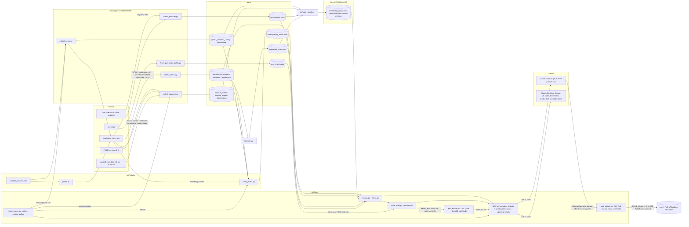
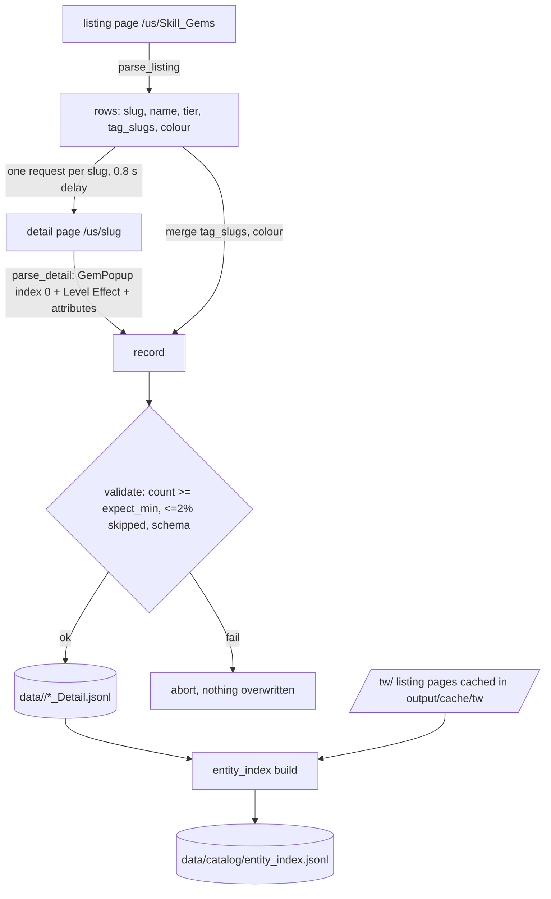
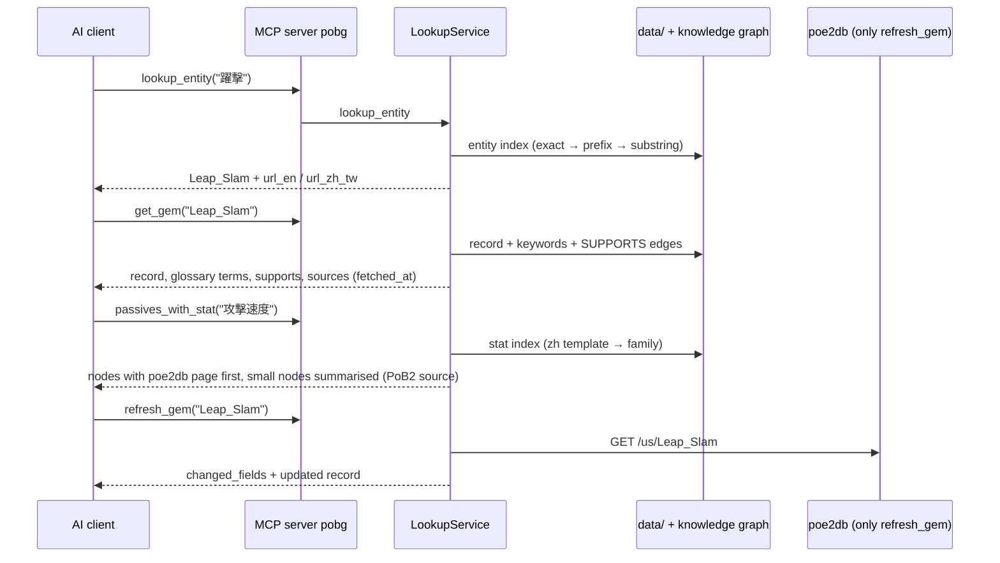
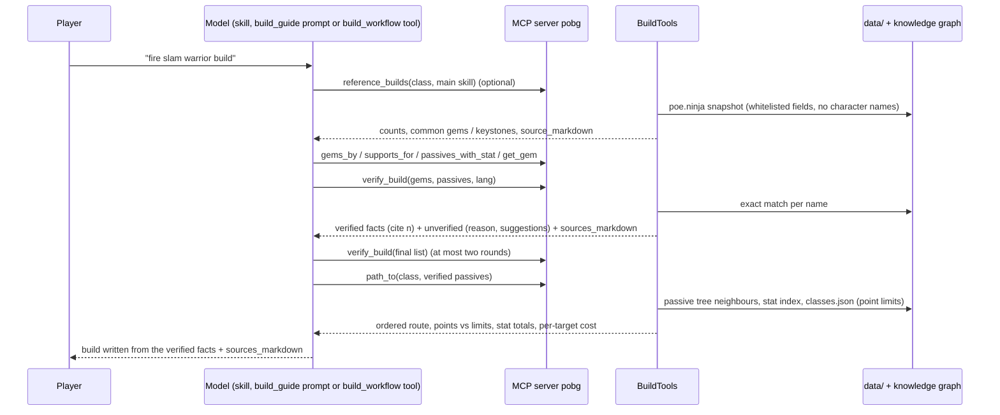
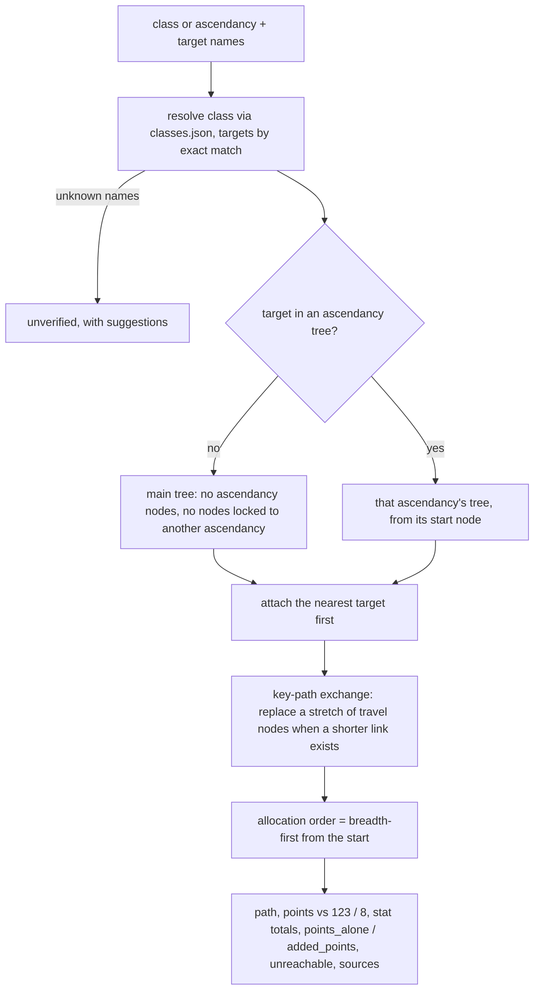
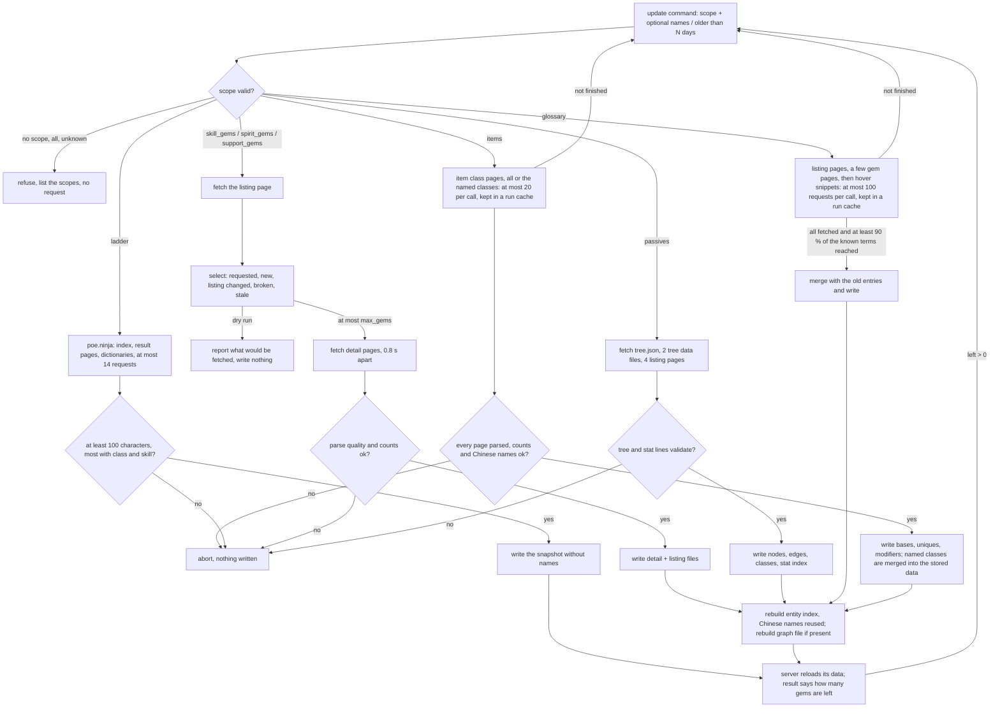

# System Flow

Updated 2026-11-12 (0.9.0: Path of Building codes and the PoB updater; 0.8.0: gear data).

## System flow



## Data flow (gem collection)



## Lookup flow (entity index)

```
query "躍擊" ──make_aliases──▶ ["躍擊"] ──exact alias──▶ Leap_Slam (skill_gem)
                                                   ├─ url_en  https://poe2db.tw/us/Leap_Slam
                                                   ├─ url_zh_tw https://poe2db.tw/tw/Leap_Slam
                                                   └─ record() → full JSON from data/skill_gems/Skill_Gems_Detail.jsonl
```

## Tool flow



## Cited build flow

The model searches freely, but only names that `verify_build` finds by exact match (slug,
English or Traditional Chinese name, passive node id) may appear in the answer. The source list
is rendered by code, not by the model. Names that were removed are echoed inside code spans, so
nothing the caller typed can render as a link or as HTML. Class and ascendancy start nodes do
not verify as passives.



## Passive pathing



## Data commands (status and update)

`update` always names one scope. Gem scopes are capped per call and repeated until nothing is
left; a gem that was selected but not fetched yet keeps its old listing row, so the next call
selects it again.



`status` reads the local files only. With the online check it runs the catalog probe (about 19
requests) and reports pages that no longer parse and newer passive tree versions.
